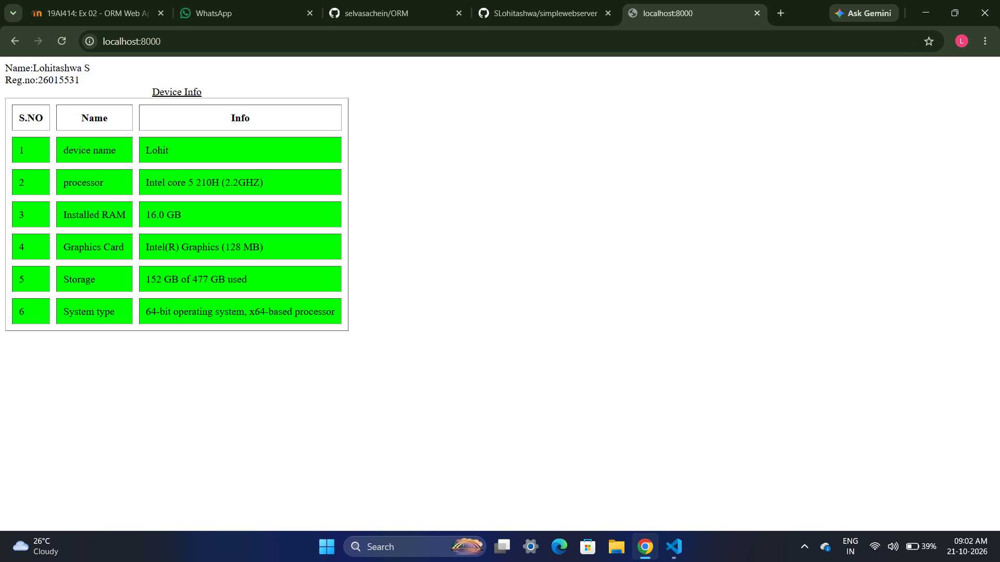
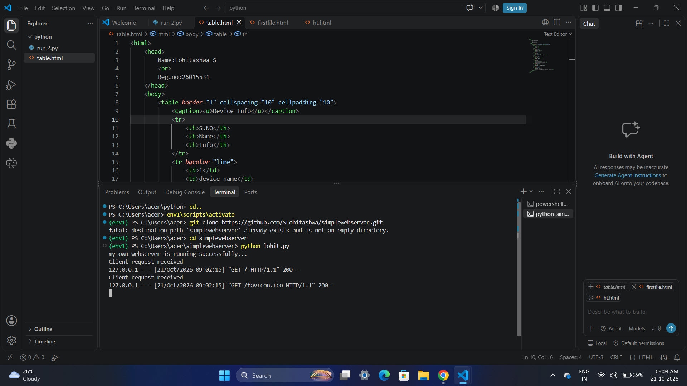

# EX01 Developing a Simple Webserver
## Date:28.09.26

## AIM:
To develop a simple webserver to serve html pages and display the Windows Specifications of your Laptop.

## DESIGN STEPS:
### Step 1: 
HTML content creation.

### Step 2:
Design of webserver workflow.

### Step 3:
Implementation using Python code.

### Step 4:
Import the necessary modules.

### Step 5:
Define a custom request handler.

### Step 6:
Start an HTTP server on a specific port.

### Step 7:
Run the Python script to serve web pages.

### Step 8:
Serve the HTML pages.

### Step 9:
Start the server script and check for errors.

### Step 10:
Open a browser and navigate to http://127.0.0.1:8000 (or the assigned port).

## PROGRAM:
```
from http.server import HTTPServer, BaseHTTPRequestHandler
content = """
<html>
    <head>
        Name:Lohitashwa S
        <br>
        Reg.no:26015531
    </head>
    <body>
        <table border="1" cellspacing="10" cellpadding="10">
            <caption><u>Device Info</u></caption>
            <tr>
                <th>S.NO</th>
                <th>Name</th>
                <th>Info</th>
            </tr>
            <tr bgcolor="lime">
                <td>1</td>
                <td>device name</td>
                <td>Lohit</td>
            </tr>
            <tr bgcolor="lime">
                <td>2</td>
                <td>processor</td>
                <td>Intel core 5 210H (2.2GHZ)</td>
            </tr>
            <tr bgcolor="lime">
                <td>3</td>
                <td>Installed RAM</td>
                <td>16.0 GB</td>
            </tr>
            <tr bgcolor="lime">
                <td>4</td>
                <td>Graphics Card</td>
                <td>Intel(R) Graphics (128 MB)</td>
            </tr>
            <tr bgcolor="lime">
                <td>5</td>
                <td>Storage</td>
                <td>152 GB of 477 GB used</td>
            </tr>
            <tr bgcolor="lime">
                <td>6</td>
                <td>System type</td>
                <td>64-bit operating system, x64-based processor</td>
            </tr>
        </table>
    </body>
</html> 
"""
class myhandler(BaseHTTPRequestHandler):
    def do_GET(self):
        print("Client request received")
        self.send_response(200)
        self.send_header('content-type', 'text/html; charset=utf-8')
        self.end_headers()
        self.wfile.write(content.encode())
server_address = ('',8000)
httpd = HTTPServer(server_address,myhandler)
print("my own webserver is running successfully...")
httpd.serve_forever()

```


## OUTPUT:
webpage


webserver


## RESULT:
The program for implementing simple webserver is executed successfully.
